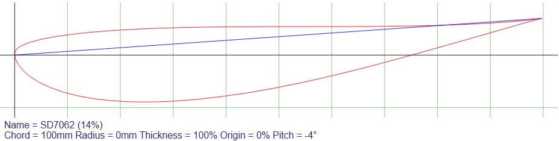
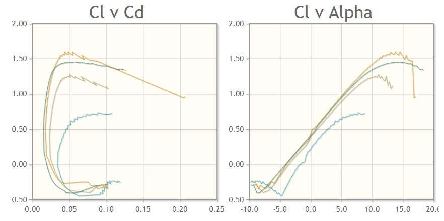
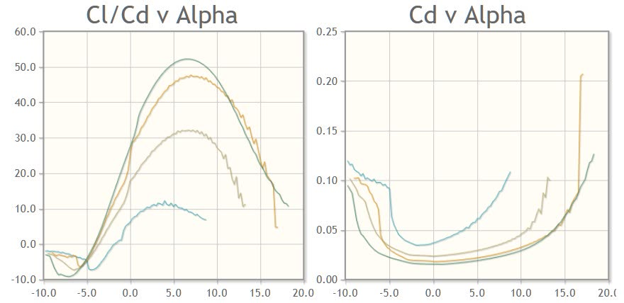
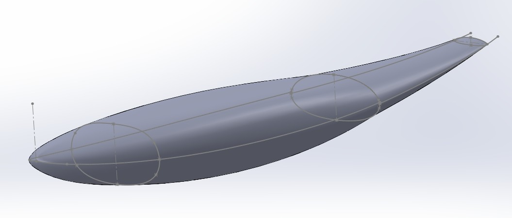
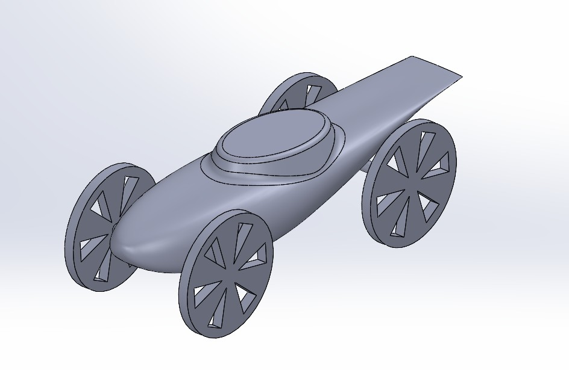

**EML 3303C Mechanical Engineering Measurements. Completed July 2025**

The course asked me to design a car and measure its drag coefficient experimentally. The car went into a laser vapor wind tunnel for two reasons.
A strain gauge attached to the car measured the drag force, and the tunnel let us visualize the fluid boundary layer.
I used concepts from EAS 3101 Fundamentals of Aerodynamics to guide the design.
 
**Project goals**
- Design a small scale car that minimizes drag in wind tunnel testing while meeting the project's mass constraints.
- Use an inverted airfoil body to generate downforce, increasing tire friction to counteract drag.
- Fabricate the design and validate its drag performance experimentally against a benchmark car.

<video class="lazy-video" loop muted playsinline preload="none" style="width: 500px;">
<source src="/assets/video/airfoil_car_tunnel.mp4" type="video/mp4">
</video>
- My design is based on the idea that a heavier car has more friction between axle and body and between wheel and ground. That friction could help counteract drag force.
- So the question was how to increase the car's total weight beyond what the project's mass constraints seemed to allow.
- My answer was an inverted wing design. Its downforce would add to the car's weight, increasing friction in the system and decreasing the measured drag force.

Project role: **Lead CAD Designer**. I modeled the car after an inverted airfoil.

- I chose the SD7062 foil because it's optimized for low Reynolds number flow, which gives a high lift coefficient even at the chamber's low airspeeds.
- Its thicker cambered body was also needed so the 3D print's cavity could hold enough sand to meet the weight requirement.
- I pitched it at -4 degrees based on the foil's drag polars, shown below.

- These are the SD7062 airfoil's drag polars (Cl vs Cd, Cl vs alpha, Cl/Cd vs alpha and Cd vs alpha), plotted at four different Reynolds numbers to pick an angle of attack (AOA).
- The Cl/Cd vs alpha graph peaks at 4 degrees AOA for low Reynolds number flow, and efficiency improves at higher Reynolds numbers.

- I saved the selected foil outline and camber line as a CSV and imported it into SolidWorks as the outline for the base car model.
- I exported the model as a STEP file and made it on my 3D printer. I paused the print before the top layer and filled the cavity with sand.

**Testing and results**

In the wind tunnel the car was mounted to a strain gauge drag sensor read through a LabVIEW VI. Drag force was computed from the measured scale weight as:
 
 <strong>D = 2.1W + 0.31</strong>.
 
At maximum tunnel speed the car recorded drag forces of 22.15N, 28.03N, 24.46N, 21.94N and 22.36N across five runs. That's noticeably higher than the 11.65N to 15.64N measured on a TA supplied benchmark car under the same conditions. The inverted airfoil's downforce did its job of loading the wheels. This test setup measures downforce driven friction as part of the drag signal, though, so that same load showed up directly in the drag reading.

A hysteresis sweep ramped the speed from about a fifth of max up to full speed and back down, in five steps each way. The up and down sweeps tracked closely (for example 20.26N at 15.39 m/s ramping up vs. 19.0N at 15.18 m/s ramping down). The car's drag response showed little hysteresis.

During testing the airflow kept blowing the wheels off the axle. A wooden wedge cut and driven into the axle end held them in place for the rest of the test runs.
