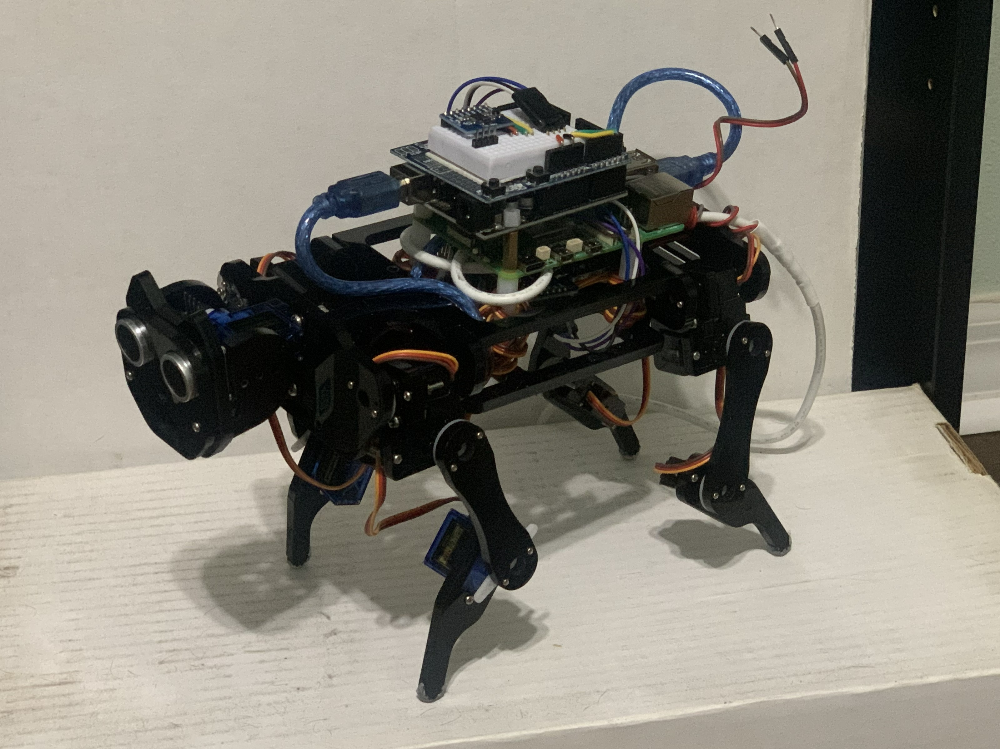
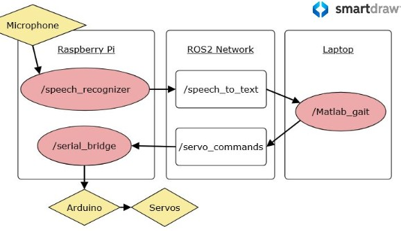
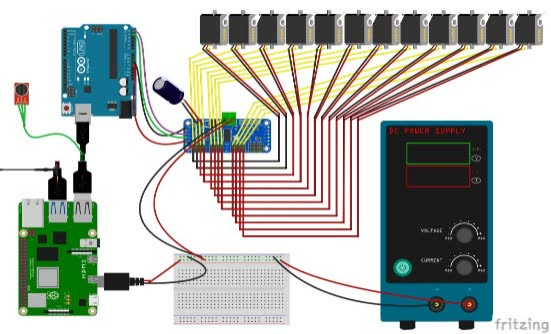

**Personal project. Completed March 2026**

A prototype of my capstone project, built as a proof of concept for [Anky](/projects/bring-roar-to-life/) before committing
to the full scale robot. I built it entirely on my own, outside the team's official senior design work. That way the controls
and electrical architecture for the full robot would already be planned out and working. It also served as a fallback, so
the team would still have a functioning robot even if my reinforcement learning model didn't pan out in time.
 

**Project goals**
- Establish the ROS2 node architecture and communication method that Anky would later inherit.
- Prototype the electrical wiring and power delivery scheme for the leg servos and sensors.

**Project overview**

<video class="lazy-video" loop muted controls playsinline preload="none" style="width: 500px;">
<source src="/assets/video/catbot_walking_full_demo.mp4" type="video/mp4">
</video>
- In this full demo a spoken "Hey Anky" command triggers the ROS2 speech recognizer. That triggers MATLAB to compute a joint space trajectory
  and send it back to the Pi, which passes it to the Arduino over serial.
- Saying "Hey Anky, Stop" interrupts the gait midstride. This confirmed the voice controlled stop command worked in real time.
- The final version could control speed and gait type, but it had no IMU for stabilization.

- The ROS2 architecture routes a spoken command through a `/speech_recognizer` node on the Raspberry Pi, to the MATLAB joint solver and back to the Pi.
- `/serial_bridge` passed the resulting servo commands from ROS2 to an Arduino, which drove the leg servos directly.
- This pipeline became the foundation for my capstone project's voice teleoperation structure.

<video class="lazy-video" loop muted playsinline preload="none" style="width: 500px;">
<source src="/assets/video/matlab_gait_example.mp4" type="video/mp4">
</video>
- I used MATLAB's Robot Toolbox to compute and visualize the inverse kinematics trajectory for each leg.
- This let me validate the gait pattern and end effector trajectories before deploying them to hardware.
- The leg order, step size and gait duty factor are all parameters, so the gait type can be changed quickly.

<video class="lazy-video" loop muted playsinline preload="none" style="width: 400px;">
<source src="/assets/video/catbot_walking_simple.mp4" type="video/mp4">
</video>
- This is the first test of the IK driven gait. MATLAB computed the joint commands, and ROS2 passed them to the joints.
- This test confirmed the leg trajectories translated correctly from the MATLAB simulation into real servo motion.

- An Arduino Uno drove the leg servos, and a Raspberry Pi handled higher level compute. A variable DC power supply powered the servos separately from the logic.
- This wiring scheme became the baseline for my capstone project's electrical design.

The ROS2 node structure, the voice to motion pipeline and the electrical layout proven here all carried directly into [Anky](/projects/bring-roar-to-life/). On that capstone team I served as the Control Architecture Lead.
