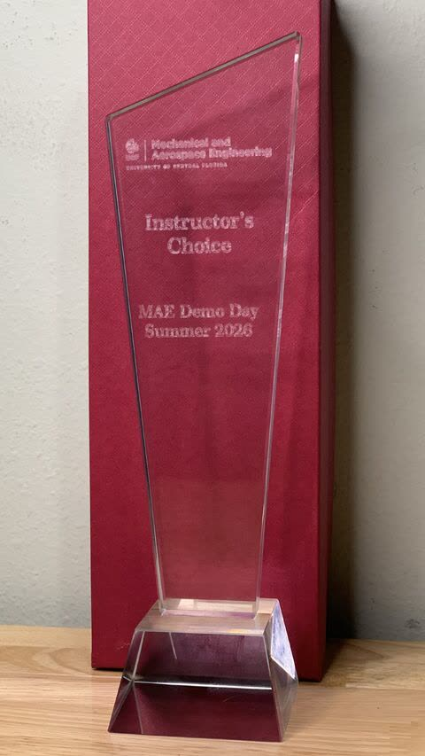
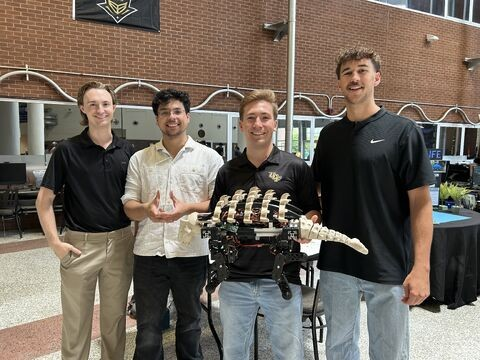
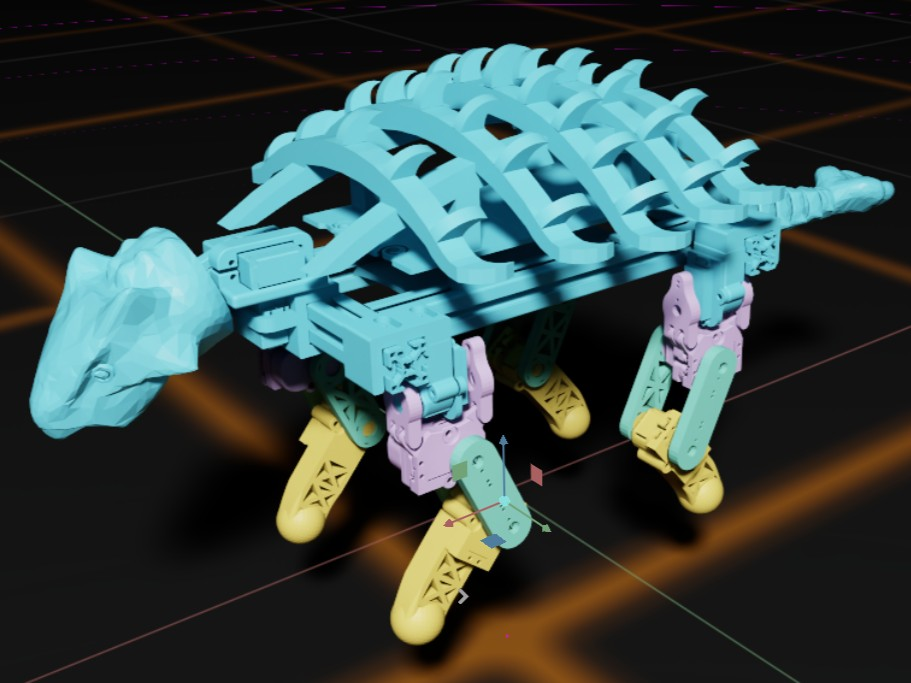
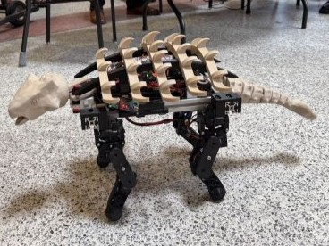
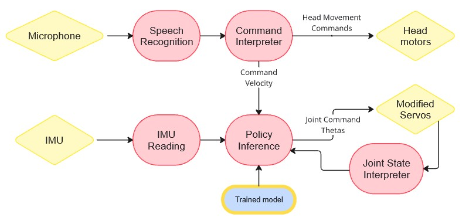
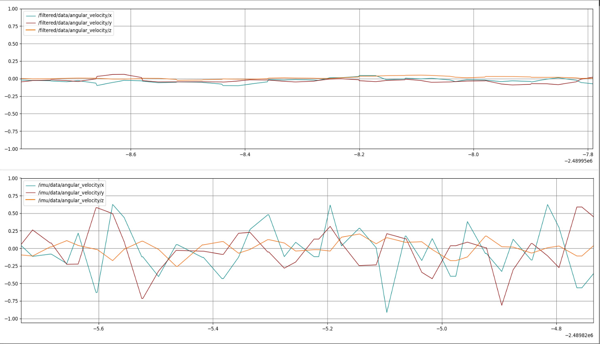
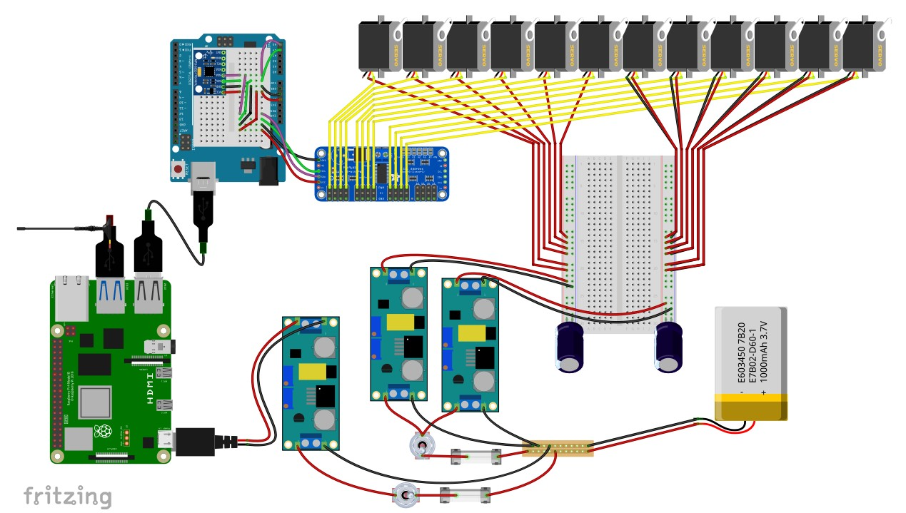
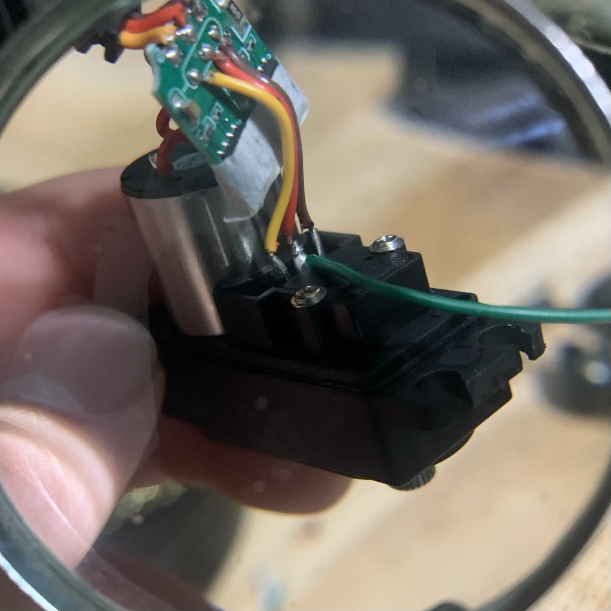
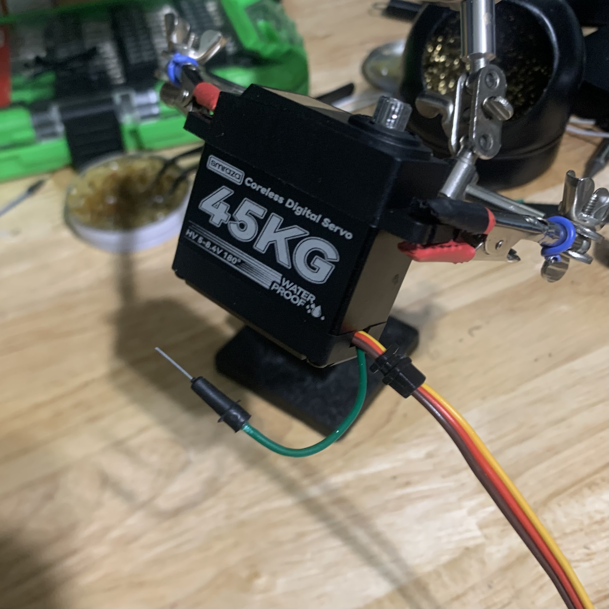
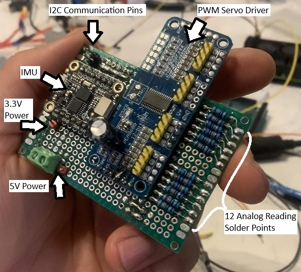

**Senior capstone project. Completed July 2026**

Anky is a low cost physical AI deployment platform with 14 degrees of freedom (DOF), built from 3D printed parts and hobby level electronics.
A fully student led team of 5 mechanical engineering majors designed and built it. We set out to prove what soon to be grads can achieve with zero guidance.
It's by far the most exciting project I've been part of.
 
**Project goals**
- Locomotion controlled by a machine learning model developed in Isaac Lab, with inference running in ROS2 on Ubuntu Linux.
- Proportions, motion and anatomy that resemble an ankylosaurus.
- Voice controlled teleoperation triggered by the activation phrase "Hey, Anky!"

[View the code on GitHub](https://github.com/Miguel-GCoca/ankybot)

**Results**

<video class="lazy-video" loop muted playsinline preload="none" style="width: 400px;">
<source src="/assets/video/first_full_test.mp4" type="video/mp4">
</video>
<video class="lazy-video" loop muted playsinline preload="none" style="width: 400px;">
<source src="/assets/video/reboot_sequence.mp4" type="video/mp4">
</video>

- Anky walked, responded to voice commands and recovered from external pushes.
- It won the Faculty's Choice Award at UCF's Summer '26 Senior Design Showcase.

Project role: **Technical Lead**. I made sure the team reached its stated goals and provided mentorship.

- Mentored teammates and classmates on programming, controls and electromechanical design.
- Led weekly meetings and discussions to track long term and time sensitive project milestones.
- Ran task delegation and milestone reporting to monitor progress at both the individual and team level.

Project role: **Control Architecture Lead**. I developed a machine learning policy and ROS2 nodes on Ubuntu Linux.

The video below shows the second generation Anky learning to walk over 6 thousand iterations (top right corner).
Each iteration had 1024 individual robot environments, which brings the total to over 6 million training instances.
Training took about 6 hours on an RTX 2070 laptop.

<video class="lazy-video" loop muted playsinline preload="none" style="width: 500px;">
<source src="/assets/video/training.mp4" type="video/mp4">
</video>

- The team's CAD assembly was converted to URDF format and imported into NVIDIA's Isaac Lab 3.0.
- Isaac Lab lets you write custom reward and penalty functions that "motivate" the robot toward a certain goal.
- You can also simulate conditions the robot is expected to face. During Anky's training a strong impulse hit the robot at random times and in random directions. That taught it how to react to being pushed in real life.

- This graph shows the rest of the ROS2 architecture. The microphone and IMU inputs are on the left, and the servo command outputs are on the right.
- Inference for the RL policy ran inside a ROS2 node, shown as the blue ellipse.
- Closed loop feedback for the leg joints comes from modified servos (see the electrical section).

<video class="lazy-video" loop muted playsinline preload="none" style="width: 500px;">
<source src="/assets/video/siminloop.mp4" type="video/mp4">
</video>
- I used simulation in the loop testing in Isaac Sim to prove my control architecture worked.
- The trained model ran on a Raspberry Pi and read a simulated IMU and encoders over ROS2. Its commanded joint angles (thetas) were then routed back to the sim.
- This was done before we filed any purchase order. Proving the design could work before fabrication began saved time and money.

- A low pass filter smoothed the IMU data. The bottom graph is the raw angular velocity data with plenty of noise, and the top graph is the filtered result.
- Both the IMU and the position feedback readings needed filtering. Without it the robot would try wildly to correct for these random fluctuations.
- This data was recorded with ROS2 bag for analysis in graphing software.

<video class="lazy-video" loop muted playsinline preload="none" style="width: 500px;">
<source src="/assets/video/first_walking_test_wide.mp4" type="video/mp4">
</video>
- This video is my first deployment of the trained policy and the first time I saw what it could do on physical hardware.
- Because the policy was trained entirely in simulation, it had already seen a "walk forward" command millions of times and knew exactly how to carry it out.
- That first test met our functional goals. All that remained was refinement.

Project role: **Electrical Design Lead**. I selected the electronic components and designed the power and safety systems.

- While designing power delivery for the servos, I found that the worst case of every servo at stall torque would draw over 40 amps. At 8.4 volts that would drain our battery in minutes.
- Capacitors wired in parallel with the servos smooth out the voltage drops that happen when the servos draw power.
- Each buck converter was rated for 20 amps. The motors could draw over 40, so I used two.
- The analog feedback wiring isn't shown in this image.

<video class="lazy-video" loop muted playsinline preload="none" style="width: 260px;">
<source src="/assets/video/servo_measurement.mp4" type="video/mp4">
</video>

- Getting position feedback only took a wire soldered to the servo's internal potentiometer.
- After calibrating the potentiometer reading, I estimated the servos' transfer function with a step response test. I assumed a second order system.
- I repeated the test with the limbs attached. From the response time and each limb segment's second moment of inertia I calculated the stiffness and damping of each joint, for accurate simulation and training in Isaac Lab.

- The protoboard pictured is a custom Arduino Mega hat. It integrates the servo driver, IMU, analog reading points, I2C communication and power for all components.
- The 12 analog reading solder points sit close together, so EMI shielded wires carry the servo potentiometer feedback signals without crosstalk.

<video class="lazy-video" loop muted playsinline preload="none" style="width: 500px;">
<source src="/assets/video/test_exposed_wiring.mp4" type="video/mp4">
</video>
- This test verified all connections were sound before the electronics were enclosed.
- The Arduino Mega hadn't arrived yet, so this test used three Arduino Unos to read joint positions.
- The AI model had no idea what to do upside down, so it moves seemingly at random.

**Cost breakdown**. All of Anky's parts came to $1,171.43.

3D printed structure and hobby servos kept the cost low. The Raspberry Pi and the two batteries alone make up over a third of the total.

| Category | What it covers | Cost |
|---|---|---|
| Power | Two LiPo batteries, charger, buck converters, fuse, power switch, capacitor, USB C pigtail | $319.93 |
| Computing and sensing | Raspberry Pi 5, Arduino Mega, 9 DOF IMU, Wi-Fi dongle, USB microphone | $300.65 |
| Actuation | 45 kg leg servos, 10 kg head servos, servo driver, servo extension cables | $284.73 |
| Structure | PLA filament, 80/20 aluminum extrusion and connectors, fasteners, threaded inserts, bearings, epoxy, anti slip silicone | $218.79 |
| Wiring | Wire, crimp terminals, heat shrink, protoboards | $47.33 |
| **Total** | | **$1,171.43** |

Swapping the protoboard for a custom PCB would add about $200. The robot wasn't designed for mass production, and building one takes a team that knows the design well.
