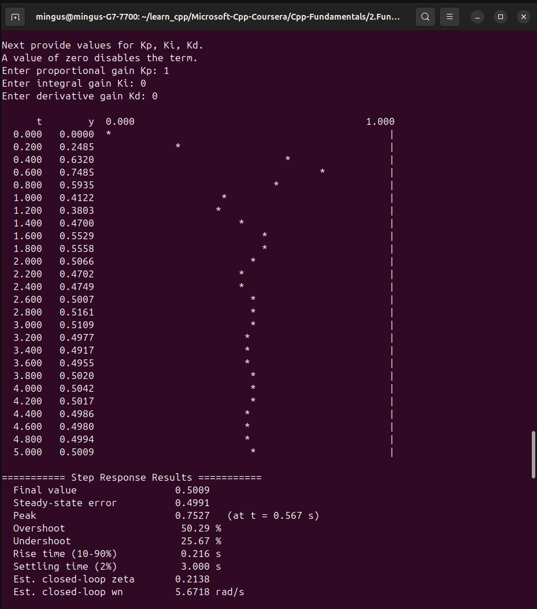
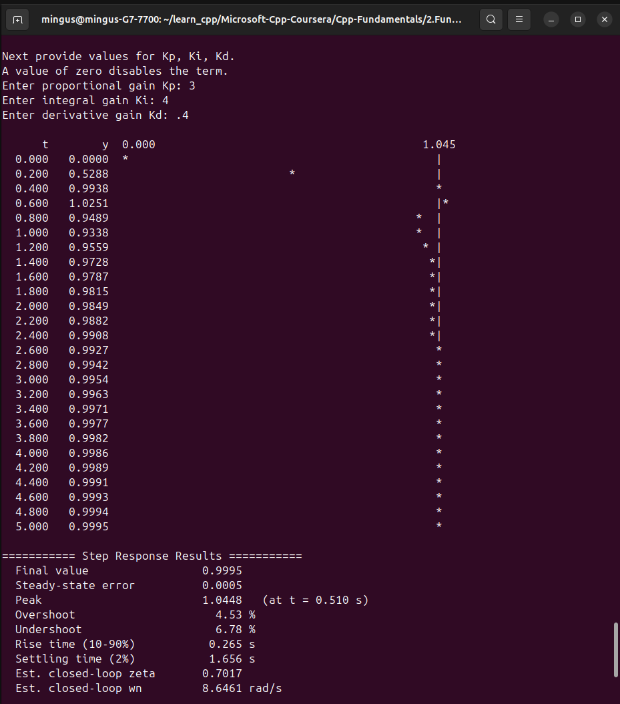
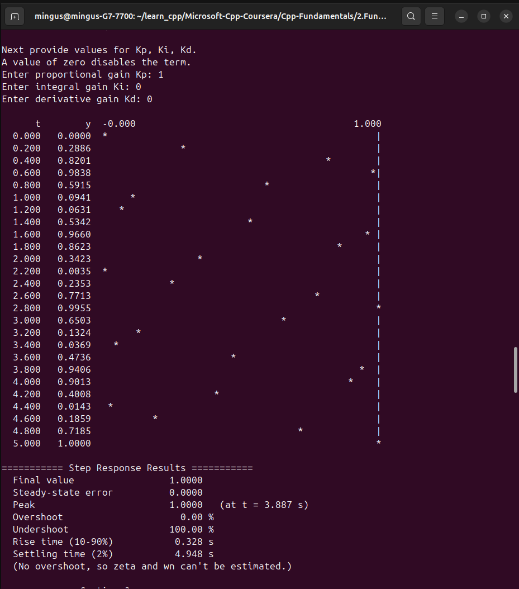
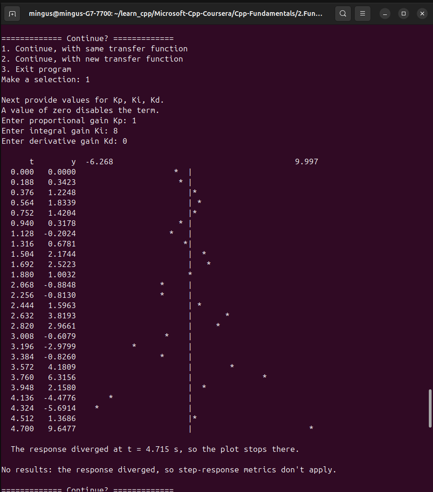
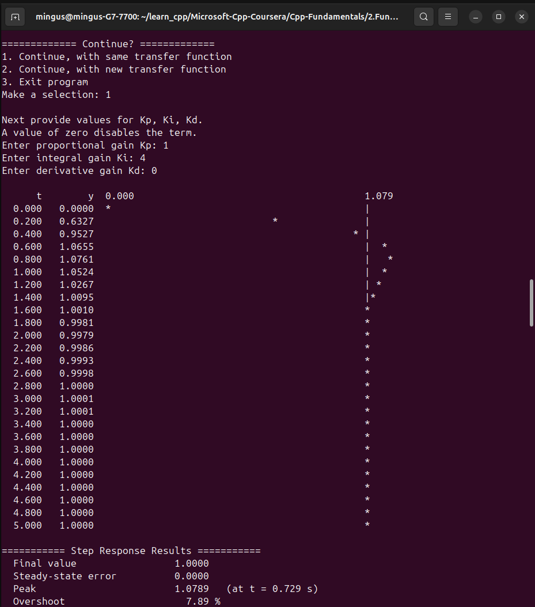
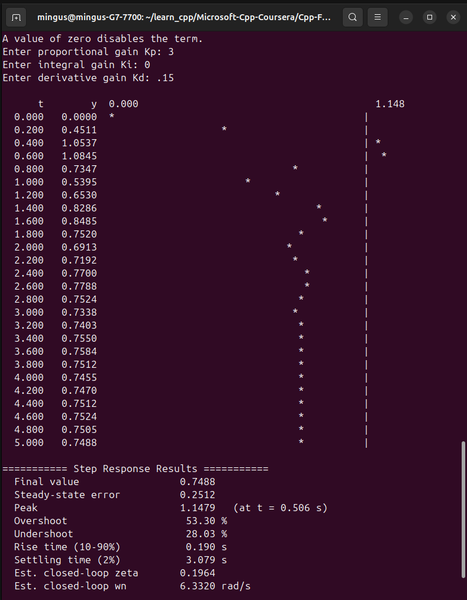

**C++ Programming Fundamentals Capstone (Microsoft, Coursera). In progress: 2 of 4 utilities finished**

The capstone for Microsoft's *C++ Programming Fundamentals* course on Coursera asks for a command-line utility: a main menu, at least four utility functions, input validation, clear feedback, and well-organized code. The course suggests simple utilities such as a BMI calculator, a temperature converter or a palindrome checker. **I built robotics and controls tools instead**, because that's the field I'm working toward.

The result is a menu-driven program with an inverse kinematics calculator and a control-systems simulator, and the simulator's output matches the exact control-theory answers to within about 1% ([see the checks](#verified-against-theory)).

| | Utility | Status |
|---|---|---|
| 1 | 3-DOF inverse kinematics calculator | **Done** |
| 2 | Plant + PID controller simulator | **Done** |
| 3 | 1D Kalman filter | Planned |
| 4 | Go-to-goal controller | Planned |

[View the code on GitHub](https://github.com/Miguel-GCoca/Microsoft-Cpp-Coursera/tree/main/Cpp-Fundamentals/2.Fundamentals-Capstone/basics_capstone)

## Utility 1: 3-DOF inverse kinematics calculator

You describe a 3-joint robot arm and a target point in space, and the program computes the **joint angles** that put the arm's tip on that point.

- **The arm:** a base that rotates about the vertical axis (θ1), a shoulder (θ2) and an elbow (θ3). It's an RRR arm, which I call a **"spherical RRR" arm** because its workspace is a spherical shell.
- **Inputs:** the **base link length** *h* (shoulder height, *h* ≥ 0), link lengths *L*1 and *L*2 (> 0), and the target (*x*, *y*, *z*).
- **Outputs:** **both** solutions, **elbow-up** and **elbow-down**, printed in degrees.

### How it works

<ol class="eq-steps">
<li><strong>Base angle</strong>
θ1 = atan2(<i>y</i>, <i>x</i>)</li>
<li><strong>Reduce to a 2D problem in the arm's plane:</strong> horizontal reach <i>r</i>, height above the shoulder <i>s</i>, and distance from shoulder to target <i>d</i>
<i>r</i> = √(<i>x</i>² + <i>y</i>²) &nbsp;&nbsp; <i>s</i> = <i>z</i> − <i>h</i> &nbsp;&nbsp; <i>d</i> = √(<i>r</i>² + <i>s</i>²)</li>
<li><strong>Elbow angle, from the law of cosines.</strong> Elbow-down is θ3 = +acos(…) and elbow-up is θ3 = −acos(…). The cosine is clamped to [−1, 1] to guard against floating-point round-off.
cos θ3 = (<i>d</i>² − <i>L</i>1² − <i>L</i>2²) / (2 <i>L</i>1 <i>L</i>2)</li>
<li><strong>Shoulder angle</strong>
θ2 = atan2(<i>s</i>, <i>r</i>) − atan2(<i>L</i>2 sin θ3, <i>L</i>1 + <i>L</i>2 cos θ3)</li>
</ol>

### Edge cases it handles

- **Reachability:** a target is reachable only if \|*L*1 − *L*2\| ≤ *d* ≤ *L*1 + *L*2, meaning it lies inside the spherical shell. Unreachable targets get an error message, and the program asks for a new target.
- **Singularity:** if the target is straight above or below the base (*x* = *y* = 0), θ1 is undefined, because *any* base rotation works. The program detects this, tells the user, and prints "any" for θ1.
- **Units:** calculations use radians internally; the output is converted to degrees.

<!-- TODO: replace these three placeholders with the IK terminal screenshots
     (same 929 x 1054 size as the PID ones), saved to
     assets/img/projects/cpp-robotics-capstone/. -->

<strong>Screenshot coming soon: normal run</strong>The ASCII arm diagram, the inputs, and both elbow-up and elbow-down solutions.

<strong>Screenshot coming soon: unreachable target</strong>The error message and the re-prompt for a new target.

<strong>Screenshot coming soon: singularity</strong>A target at <i>x</i> = <i>y</i> = 0, producing the warning and "θ1: any".

## Utility 2: Plant + PID controller simulator

You pick a **plant** (the system being controlled) and enter its parameters, then enter **PID gains** (*K*p, *K*i, *K*d). The program simulates the closed-loop **step response**, draws it as an **ASCII plot in the terminal**, and prints a **table of control metrics**. You can then retune the gains or switch plants without restarting. The program prints this block diagram in its intro:

<pre class="term-block" aria-label="Block diagram: reference r minus feedback y gives error e, which feeds the PID, whose output u drives the plant, whose output y is fed back">reference r ──►(+)──► error e ──► [ PID ] ──► u ──► [ Plant ] ──┬──► y
                ▲(−)                                            │
                └───────────────────────────────────────────────┘</pre>

### How it works

**Three plant types**, all converted into one general model, *a*2·*y*'' + *a*1·*y*' + *a*0·*y* = *b*0·*u*:

| Menu option | Transfer function | Example |
|---|---|---|
| 1st order | *K* / (τ*s* + 1) | motor speed, heater temperature |
| 2nd order | *K*·ωn² / (*s*² + 2ζωn·*s* + ωn²) | spring-mass systems, positioning stages |
| Robot joint | 1 / (<i>Js</i>² + <i>cs</i> + <i>k</i>) | a joint with inertia *J*, damping *c*, stiffness *k* |

**Simulation:** fixed time step **dt = 1 ms**, 5-second run (5,001 samples). The plant is integrated with **semi-implicit (symplectic) Euler**: velocity is updated first, then position using the *new* velocity. I chose it over plain Euler because plain Euler adds artificial energy every step and would make an undamped system appear to blow up. ([Highlight 3](#highlight-3-a-frictionless-system-that-never-settles) shows this choice paying off.)

**PID controller**, discretized each step:

<ol class="eq-steps">
<li>Error, integral (accumulated as <i>e</i>·dt each step) and derivative
<i>e</i> = <i>r</i> − <i>y</i> &nbsp;&nbsp; ∫<i>e</i> += <i>e</i>·dt &nbsp;&nbsp; d<i>e</i>/d<i>t</i> = (<i>e</i> − <i>e</i>prev) / dt</li>
<li>Control output
<i>u</i> = <i>K</i>p·<i>e</i> + <i>K</i>i·∫<i>e</i> + <i>K</i>d·d<i>e</i>/d<i>t</i></li>
<li><strong>Derivative-kick prevention:</strong> the previous error starts at the <em>initial</em> error, so the first step doesn't produce a huge derivative spike when the setpoint jumps.</li>
</ol>

**Output:**

- **ASCII plot:** time runs *down* the page and *y* runs *across*. `*` is the response *y* and `|` is the setpoint. 25 rows are taken from the 5,001 samples, and the horizontal axis is **autoscaled** to the data. The numbers at the top are the left-edge and right-edge values of the *y* axis.
- **Metrics table,** computed from all 5,001 samples: final value, steady-state error, peak (with time), overshoot %, undershoot %, rise time (10-90%), settling time (2% band), and the **estimated closed-loop ζ and ωn** (worked backward from the measured overshoot and peak time).
- **Divergence detection:** if the response becomes infinite, or grows past 10× the setpoint, the plot stops at that moment and says when it diverged, and the metrics are skipped.

### Highlights

Four runs, in order. The ASCII plot only samples 25 rows, which hides detail, so Highlights 2 to 4 (and the robot joint further down) have a translucent **white line** showing what the response actually looks like at full resolution, shifted slightly so the `*` marks stay visible. The lines are drawn from the simulation's own data (exported every 10 ms from the 1 ms run) and added for this page; the program itself only prints text. Use the button under a screenshot to hide its overlay. All four highlights use the 2nd-order plant; the other two plant types are shown [after the highlights](#not-just-second-order).

#### Highlights 1 and 2: the same plant, before and after tuning

Both runs use the same 2nd-order plant (*K* = 1, ωn = 4, ζ = 0.3). The first run uses proportional-only control with *K*p = 1 (unity gain, so effectively no tuning). The second uses full PID with *K*p = 3, *K*i = 4, *K*d = 0.4.

<figure class="term-figure">



<figcaption>Before: <i>K</i>p = 1, <i>K</i>i = 0, <i>K</i>d = 0.</figcaption>
</figure>

**Before.** The plant overshoots by **50%** and rings for about 3 s. It also **stops at 0.5**, halfway to the setpoint of 1.0, leaving a large steady-state error. This kind of ringing only happens in a second-order system, one with momentum; a first-order plant can't overshoot under proportional control.

<figure class="term-figure">



<figcaption><button type="button" class="overlay-toggle" hidden>Hide overlay</button>After: <i>K</i>p = 3, <i>K</i>i = 4, <i>K</i>d = 0.4. The axis here runs to 1.045, not 1.000. White line: full-resolution response, shifted slightly so the * marks stay visible.</figcaption>
</figure>

**After.** Overshoot drops from 50% to **4.5%**, the steady-state error is **gone**, and it settles in **1.66 s** instead of 3.0 s. Each term does its job: P speeds up the response, D damps the ringing, and I removes the leftover error. The full-resolution line shows one small overshoot peak at 0.510 s (1.0448), a shallow dip at 0.942 s (0.9318), then a slow, smooth climb onto 1.0.

| Metric | Before (P only) | After (full PID) |
|---|---|---|
| Final value | 0.5009 | 0.9995 |
| Steady-state error | 0.4991 | 0.0005 |
| Peak | 0.7527 at 0.567 s | 1.0448 at 0.510 s |
| Overshoot | 50.29% | 4.53% |
| Undershoot | 25.67% | 6.78% |
| Rise time (10-90%) | 0.216 s | 0.265 s |
| Settling time (2%) | 3.000 s | 1.656 s |
| Est. closed-loop ζ | 0.2138 | 0.7017 |
| Est. closed-loop ωn | 5.6718 rad/s | 8.6461 rad/s |

#### Highlight 3: a frictionless system that never settles

<figure class="term-figure">



<figcaption><button type="button" class="overlay-toggle" hidden>Hide overlay</button>2nd order, <i>K</i> = 1, ωn = 4, <b>ζ = 0</b>; <i>K</i>p = 1, <i>K</i>i = 0, <i>K</i>d = 0. White line: full-resolution response, shifted slightly so the * marks stay visible.</figcaption>
</figure>

With **no damping**, the response oscillates between 0 and 1 for the whole run. With no friction, energy just moves back and forth between position and velocity.

The ASCII plot looks irregular because its 0.2 s rows don't line up with the 1.11 s oscillation period. The overlay shows the full-resolution curve is a **perfect sine**: peaks of exactly 1.000 at 0.555, 1.666, 2.776, 3.887 and 4.998 s, and troughs of exactly 0.000 at 1.110, 2.221, 3.332 and 4.442 s. The period is 1.11 s, matching the theory value 2π/√32.

The amplitude stays **exactly constant for 5 seconds**. That's the semi-implicit Euler choice paying off: plain Euler would have made it grow.

The plot is the result here. The metrics table under it doesn't describe a response that never settles (its final value only matches the setpoint because t = 5 s happens to land on a peak), so I don't quote it.

#### Highlight 4: real instability (too much integral)

<figure class="term-figure">



<figcaption><button type="button" class="overlay-toggle" hidden>Hide overlay</button>Same plant as Highlight 1; <i>K</i>p = 1, <b><i>K</i>i = 8</b>, <i>K</i>d = 0. White line: full-resolution response, shifted slightly so the * marks stay visible.</figcaption>
</figure>

Each swing is larger than the last, until the response diverges at **t = 4.715 s** and the program stops the plot and skips the metrics.

This instability is *physically real*: a real machine with these gains would do the same. Routh-Hurwitz stability analysis on the closed loop gives the limit **Ki < 4.8** for this plant with *K*p = 1, and *K*i = 8 is past it.

The overlay shows what the 0.188 s rows miss: the true peaks are larger than the plotted points suggest. Peaks reach 1.844, 2.623, 3.957 and 6.386; troughs reach −0.211, −1.192, −2.991 and −6.268. After the last trough it climbs past +10 at 4.715 s, where the data ends.

### Not just second order

All four highlights use the 2nd-order plant. These two runs show the other plant models from [the table above](#how-it-works-1) working normally.

<figure class="term-figure">



<figcaption>1st order, <i>K</i> = 2, τ = 0.5; <i>K</i>p = 1, <b><i>K</i>i = 4</b>, <i>K</i>d = 0 (PI control). The results table is cut off in this screenshot; the key numbers are in the table below.</figcaption>
</figure>

**1st order (motor or heater style).** A fast rise, a modest **7.9% overshoot**, then a smooth settle onto the setpoint with **no steady-state error**. With P alone, this plant would stop at 0.667. The integral term is what carries it all the way to 1.0.

A first-order plant *can't* overshoot by itself. The overshoot here comes entirely from the integral term, which builds up while the error is large and briefly pushes past the target.

<figure class="term-figure term-figure--narrow">



<figcaption><button type="button" class="overlay-toggle" hidden>Hide overlay</button>Robot joint, <i>J</i> = 0.1, <i>c</i> = 0.1, <i>k</i> = 1; <b><i>K</i>p = 3</b>, <i>K</i>i = 0, <b><i>K</i>d = 0.15</b> (PD control). White line: full-resolution response, shifted slightly so the * marks stay visible.</figcaption>
</figure>

**Robot joint with stiffness and damping.** A rotating joint with inertia *J* (kg·m²), viscous damping *c* and a spring stiffness *k*, driven by a torque *u*, with transfer function 1 / (<i>Js</i>² + <i>cs</i> + <i>k</i>). It's springy and lightly damped: it swings well past the target (**53% overshoot**), oscillates about **2½ times** with a period of about 1 s, and settles after about **3.1 s**, at **0.75, not 1.0**. The full-resolution line fills in the true peaks between the rows: peak 1.1479 (0.506 s), trough 0.5389 (1.012 s), peak 0.8620 (1.519 s), trough 0.6906 (2.025 s), peak 0.7815 (2.532 s), trough 0.7333 (3.038 s), then smaller wiggles settling around 0.75.

That final value is correct, and it can be predicted exactly. At steady state the spring torque *k*·*y* must equal the controller torque *K*p·(1 − *y*), so *y* = *K*p / (*k* + *K*p) = 3/4 = **0.75**. The program reports 0.7488 at t = 5 s because a tiny bit of oscillation is still left. The spring pushes back, so a PD controller has to keep an error to hold the joint against it. That's why real joint controllers add an integral term or gravity/spring compensation.

| Metric | 1st order (PI) | Robot joint (PD) |
|---|---|---|
| Final value | 1.0000 | 0.7488 |
| Steady-state error | 0.0000 | 0.2512 |
| Peak | 1.0789 at 0.729 s | 1.1479 at 0.506 s |
| Overshoot | 7.89% | 53.30% |
| Undershoot | 0.22% | 28.03% |
| Rise time (10-90%) | 0.327 s | 0.190 s |
| Settling time (2%) | 1.266 s | 3.079 s |
| Est. closed-loop ζ | n/a | 0.1964 |
| Est. closed-loop ωn | n/a | 6.3320 rad/s |

There are no ζ or ωn estimates for the PI run: PI adds a zero to the closed loop, so the standard second-order formulas don't fit it.

## Verified against theory

A simulator is only useful if it's right. For setups with exact analytic answers, the measured results match them, across all three plant types:

| Check | Program measured | Exact theory | Off by |
|---|---|---|---|
| Closed-loop ωn, Highlight 1 setup | 5.6718 rad/s | √32 = 5.657 rad/s | 0.3% |
| Closed-loop ζ, Highlight 1 setup | 0.2138 | 0.212 | 0.8% |
| Overshoot, Highlight 1 setup | 50.29% | 50.6% | 0.3 points |
| Final value with P-only control, Highlight 1 setup | 0.5009 | 0.5 | 0.2% |
| 1st order (*K* = 1, τ = 0.5, *K*p = 1): rise time | 0.548 s | 2.197 × 0.25 s = 0.549 s | 0.2% |
| 1st order (*K* = 1, τ = 0.5, *K*p = 1): settling time | 0.977 s | 3.912 × 0.25 s = 0.978 s | 0.1% |
| Undamped oscillation period, Highlight 3 | 1.11 s | 2π / √32 = 1.111 s | ≈0% |
| Integral stability limit, Highlight 4 setup | unstable at *K*i = 8 | stable only for *K*i < 4.8 | consistent |
| Robot joint: final value | 0.7488 | *K*p / (*k* + *K*p) = 3/4 = 0.75 | 0.2% |
| Robot joint: closed-loop ωn | 6.3320 rad/s | √40 = 6.325 rad/s | 0.1% |
| Robot joint: closed-loop ζ | 0.1964 | 0.1976 | 0.6% |
| Robot joint: overshoot | 53.30% | 53.08% | 0.2 points |

The ζ and ωn values are estimates for the **closed loop** (plant + controller), not the plant alone.

## Roadmap

**Next utilities**

- **Utility 3: 1D Kalman filter**, estimating a value from noisy measurements.
- **Utility 4: Go-to-goal controller**, steering a mobile robot to a target position.

**Planned add-ons to the PID simulator**

- **Motor datasheet presets:** real motors and joints built from datasheet values (resistance, torque constant, inertia, gear ratio).
- **Filtered derivative:** the standard industrial fix for a numerical instability in the derivative term, which can make the simulation blow up on a plant with no inertia.

## Tech details

- **Build:** CMake, compiled with `-Wall -Wextra`.
- **Structure:** multi-file, with a header and source file per utility (`inverse_kinematics`, `pid_simulator`, `user_interface`, `math_utils`), plus validated numeric input shared across utilities.
- **Code:** [Microsoft-Cpp-Coursera on GitHub](https://github.com/Miguel-GCoca/Microsoft-Cpp-Coursera/tree/main/Cpp-Fundamentals/2.Fundamentals-Capstone/basics_capstone). The capstone lives in `Cpp-Fundamentals/2.Fundamentals-Capstone/basics_capstone`.

