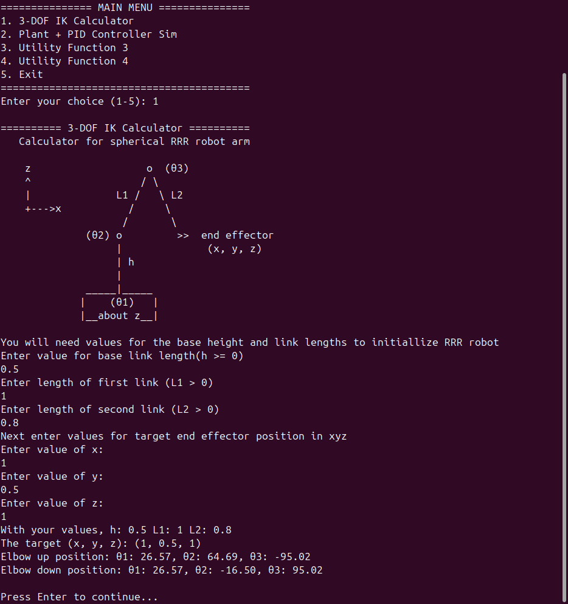
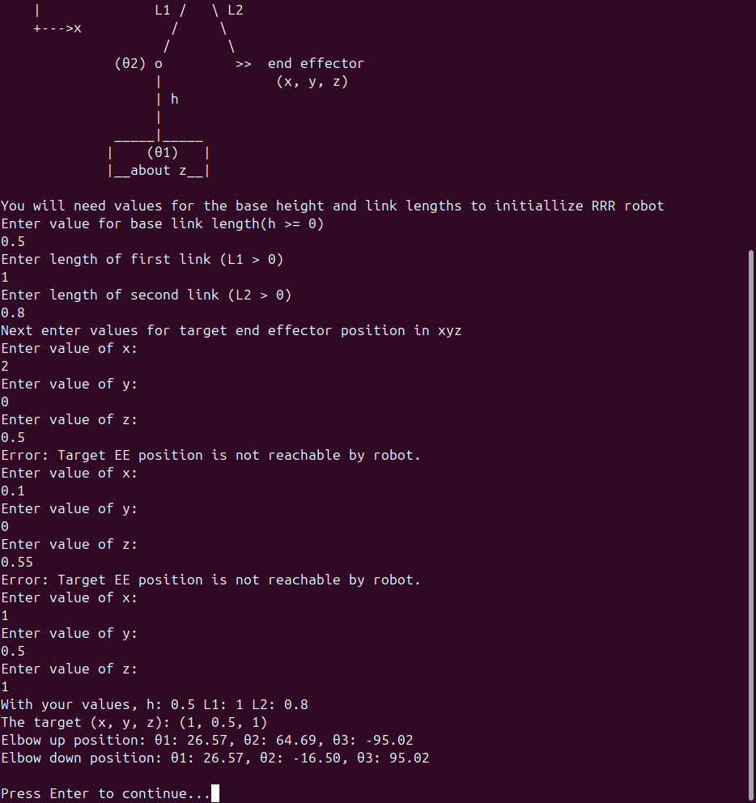
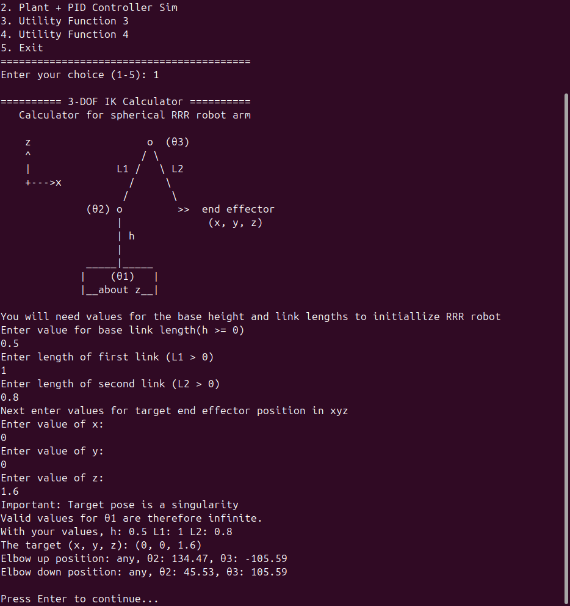

**C++ Programming Fundamentals Capstone (Microsoft, Coursera). In progress: 2 of 4 utilities finished**

The final project for Microsoft's *C++ Programming Fundamentals* course on Coursera is a command line program with a main menu and at least four utility functions. It also needs input validation, clear feedback and well organized code. The suggested ideas were simple tools like a BMI calculator, a temperature converter or a palindrome checker. I built robotics and controls tools instead, since that's the work I want to do. I also set up the code the way I'd set up a ROS 2 package, with the same folder layout, header organization, naming and build setup. That way it could move into a real ROS 2 package without shuffling files around.

So far it has two working tools, an inverse kinematics calculator and a control systems simulator. I checked the simulator against exact control theory answers, and it lands within about 1% of them ([see the checks](#verified-against-theory)).

| # | Utility | Status |
|---|---|---|
| 1 | 3-DOF inverse kinematics calculator | **Done** |
| 2 | Plant + PID controller simulator | **Done** |
| 3 | 1D Kalman filter | Planned |
| 4 | Go to goal controller | Planned |

[View the code on GitHub](https://github.com/Miguel-GCoca/Microsoft-Cpp-Coursera/tree/main/Cpp-Fundamentals/2.Fundamentals-Capstone/basics_capstone)

## Utility 1: 3-DOF inverse kinematics calculator

You give it the dimensions of a 3 joint robot arm and a point in space, and it works out the joint angles that put the arm's tip on that point.

The arm has a base that rotates about the vertical axis (θ1), a shoulder (θ2) and an elbow (θ3). That makes it an RRR arm, and I call it a "spherical RRR" arm because its workspace is a spherical shell. You enter the base link length *h* (the shoulder height, *h* ≥ 0), the link lengths *L*1 and *L*2 (both > 0) and the target (*x*, *y*, *z*). It prints both solutions, elbow up and elbow down, in degrees.

### How it works

<ol class="eq-steps">
<li><strong>Base angle</strong>
θ1 = atan2(<i>y</i>, <i>x</i>)</li>
<li><strong>Reduce it to a 2D problem in the arm's plane</strong> using the horizontal reach <i>r</i>, the height above the shoulder <i>s</i> and the distance from shoulder to target <i>d</i>
<i>r</i> = √(<i>x</i>² + <i>y</i>²) &nbsp;&nbsp; <i>s</i> = <i>z</i> − <i>h</i> &nbsp;&nbsp; <i>d</i> = √(<i>r</i>² + <i>s</i>²)</li>
<li><strong>Elbow angle from the law of cosines.</strong> Elbow down is θ3 = +acos(…) and elbow up is θ3 = −acos(…). The program clamps the cosine to [−1, 1] to guard against floating point rounding errors.
cos θ3 = (<i>d</i>² − <i>L</i>1² − <i>L</i>2²) / (2 <i>L</i>1 <i>L</i>2)</li>
<li><strong>Shoulder angle</strong>
θ2 = atan2(<i>s</i>, <i>r</i>) − atan2(<i>L</i>2 sin θ3, <i>L</i>1 + <i>L</i>2 cos θ3)</li>
</ol>

### Edge cases it handles

A target is reachable only if \|*L*1 − *L*2\| ≤ *d* ≤ *L*1 + *L*2, which means it lies inside the spherical shell. For an unreachable target the program prints an error and asks for a new one.

If the target is straight above or below the base (*x* = *y* = 0), θ1 is undefined because *any* base rotation works. The program detects this singularity, tells the user and prints "any" for θ1.

All the math runs in radians, and the output is converted to degrees.

### The calculator running

All three runs use the same robot (*h* = 0.5, *L*1 = 1, *L*2 = 0.8), which can reach anywhere from 0.2 to 1.8 away from its shoulder. I added the black box in the top right corner of each screenshot for this page. It shows the robot dimensions and target, and it isn't program output. Click or tap any screenshot on this page to see it full size.

<figure class="term-figure">



<figcaption><b>Normal run</b> for target (1, 0.5, 1). Elbow up gives θ1 26.57°, θ2 64.69° and θ3 −95.02°. Elbow down gives θ1 26.57°, θ2 −16.50° and θ3 95.02°.</figcaption>
</figure>
<figure class="term-figure">



<figcaption><b>Unreachable targets.</b> The program rejects two targets, and each one gets an error and a new prompt. Target (2, 0, 0.5) is too far away (2.0 > <i>L</i>1 + <i>L</i>2 = 1.8), and target (0.1, 0, 0.55) is too close (0.11 < |<i>L</i>1 − <i>L</i>2| = 0.2). Between them they show both edges of the spherical shell. The third target, (1, 0.5, 1), solves the same way as in the first shot.</figcaption>
</figure>
<figure class="term-figure">



<figcaption><b>Singularity.</b> Target (0, 0, 1.6) sits straight above the base, so any base angle works. The program warns about it and prints <code>any</code> in place of θ1. Elbow up gives θ2 134.47° and θ3 −105.59°. Elbow down gives θ2 45.53° and θ3 105.59°.</figcaption>
</figure>

## Utility 2: Plant + PID controller simulator

You pick a plant (the system you're controlling), type in its parameters and then type in the PID gains (*K*p, *K*i, *K*d). The program simulates the closed loop step response, draws it as an ASCII plot in the terminal and prints a table of control metrics. From there you can retune the gains or switch plants without restarting. It shows this block diagram when you open it.

<pre class="term-block" aria-label="Block diagram: reference r minus feedback y gives error e, which feeds the PID, whose output u drives the plant, whose output y is fed back">reference r ──►(+)──► error e ──► [ PID ] ──► u ──► [ Plant ] ──┬──► y
                ▲(−)                                            │
                └───────────────────────────────────────────────┘</pre>

### How it works

There are three plant types, and the program converts each one into the same general model, *a*2·*y*'' + *a*1·*y*' + *a*0·*y* = *b*0·*u*.

| Menu option | Transfer function | Example |
|---|---|---|
| 1st order | *K* / (τ*s* + 1) | motor speed, heater temperature |
| 2nd order | *K*·ωn² / (*s*² + 2ζωn·*s* + ωn²) | spring mass systems, positioning stages |
| Robot joint | 1 / (<i>Js</i>² + <i>cs</i> + <i>k</i>) | a joint with inertia *J*, damping *c*, stiffness *k* |

Each run lasts 5 seconds at a fixed 1 ms time step (5,001 samples). I integrate the plant with semi-implicit (symplectic) Euler, which updates velocity first and then uses the *new* velocity to update position. Plain (explicit) Euler adds a little extra energy to the system every step. On Highlight 3's undamped run it would have grown the swing by about 8% over the 5 seconds (peak 1.042 instead of 1.000). Semi-implicit Euler keeps it flat, as [Highlight 3](#highlight-3-a-frictionless-system-that-never-settles) shows.

The program updates the PID controller once per time step.

<ol class="eq-steps">
<li>Error, integral (accumulated as <i>e</i>·dt each step) and derivative
<i>e</i> = <i>r</i> − <i>y</i> &nbsp;&nbsp; ∫<i>e</i> += <i>e</i>·dt &nbsp;&nbsp; d<i>e</i>/d<i>t</i> = (<i>e</i> − <i>e</i>prev) / dt</li>
<li>Control output
<i>u</i> = <i>K</i>p·<i>e</i> + <i>K</i>i·∫<i>e</i> + <i>K</i>d·d<i>e</i>/d<i>t</i></li>
<li><strong>Derivative kick prevention.</strong> The previous error starts at the <em>initial</em> error, so the first step doesn't produce a huge derivative spike when the setpoint jumps.</li>
</ol>

The ASCII plot runs time *down* the page and *y* across it. A `*` marks the response *y*, and `|` marks the setpoint. The plot takes 26 evenly spaced rows from the 5,001 samples and autoscales the horizontal axis to the data. The numbers at the top are the left and right edge values of the *y* axis.

The metrics table uses all 5,001 samples. It lists the final value, steady state error, peak (with its time), overshoot %, undershoot %, rise time (10-90%), settling time (2% band) and the estimated closed loop ζ and ωn. The program works those last two backward from the measured overshoot and peak time.

If the response becomes infinite or grows past 10× the setpoint, the program stops the plot at that moment. It says when the response diverged and skips the metrics.

### Highlights

These four runs build on each other, so they're best read in order. The terminal plot only shows 26 rows, which hides a lot of detail. On Highlights 2 to 4 (and the robot joint further down) I drew a translucent white line with the full resolution response. It comes straight from the simulation's own data (exported every 10 ms from the 1 ms run) and is shifted a little so the `*` marks stay visible. The program itself only prints text, so the white lines and the black boxes in the top right corners (transfer function and gains) are additions for this page. You can hide a line with the button under its screenshot. All four highlights use the 2nd order plant, and the other two plant types come [after the highlights](#not-just-second-order).

#### Highlights 1 and 2: the same plant, before and after tuning

Both runs use the same 2nd order plant (*K* = 1, ωn = 4, ζ = 0.3). The first uses only proportional control with *K*p = 1, which is unity gain and so basically no tuning. The second uses full PID with *K*p = 3, *K*i = 4 and *K*d = 0.4.

<figure class="term-figure">



<figcaption>Before (<i>K</i>p = 1, <i>K</i>i = 0, <i>K</i>d = 0).</figcaption>
</figure>

**Before.** It overshoots by 50%, rings for about 3 s and then stalls at 0.5, only halfway to the setpoint of 1.0. That leaves a big steady state error. The ringing comes from momentum, which only a second order system has. A first order plant can't overshoot under proportional control at all.

<figure class="term-figure">



<figcaption><button type="button" class="overlay-toggle" hidden>Hide overlay</button>After (<i>K</i>p = 3, <i>K</i>i = 4, <i>K</i>d = 0.4). The axis here runs to 1.045, not 1.000. White line: full resolution response, shifted slightly so the * marks stay visible.</figcaption>
</figure>

**After.** Overshoot drops from 50% to 4.5%, the steady state error disappears, and it settles in 1.66 s instead of 3.0 s. P makes it faster, D calms the ringing and I removes the leftover error. The white line shows one small overshoot peak at 0.510 s (1.0448) and a shallow dip at 0.942 s (0.9318), followed by a slow, smooth climb onto 1.0.

| Metric | Before (P only) | After (full PID) |
|---|---|---|
| Final value | 0.5009 | 0.9995 |
| Steady state error | 0.4991 | 0.0005 |
| Peak | 0.7527 at 0.567&nbsp;s | 1.0448 at 0.510&nbsp;s |
| Overshoot | 50.29% | 4.53% |
| Undershoot | 25.67% | 6.78% |
| Rise time (10-90%) | 0.216&nbsp;s | 0.265&nbsp;s |
| Settling time (2%) | 3.000&nbsp;s | 1.656&nbsp;s |
| Est. closed loop ζ | 0.2138 | n/a |
| Est. closed loop ωn | 5.6718&nbsp;rad/s | n/a |

I left ζ and ωn out of the After column on purpose. The integral term makes this closed loop third order, so the second order formulas behind those estimates don't apply. The program still prints them (0.7017 and 8.6461 in the screenshot). The oscillating pair of poles actually has ζ ≈ 0.51 and ωn ≈ 7.43 rad/s. A slow third pole at *s* = −1.16 sits right next to the integral's zero at *s* = −4/3, and the two almost cancel. That near cancellation is why the response creeps up the last few percent to 1.0.

#### Highlight 3: a frictionless system that never settles

<figure class="term-figure">



<figcaption><button type="button" class="overlay-toggle" hidden>Hide overlay</button>2nd order, <i>K</i> = 1, ωn = 4, <b>ζ = 0</b>; <i>K</i>p = 1, <i>K</i>i = 0, <i>K</i>d = 0. White line: full resolution response, shifted slightly so the * marks stay visible.</figcaption>
</figure>

With no damping, the response swings between 0 and 1 for the whole run. There's no friction to take energy out, so the energy just trades back and forth between position and velocity.

The ASCII plot looks messy because its 0.2 s rows don't line up with the 1.11 s period. The white line shows a perfect sine underneath. Its peaks are exactly 1.000 at 0.555, 1.666, 2.776, 3.887 and 4.998 s, and its troughs are exactly 0.000 at 1.110, 2.221, 3.332 and 4.442 s. The period of 1.11 s matches the theory value of 2π/√32.

The amplitude stays exactly constant for all 5 seconds because of semi-implicit Euler. Plain Euler would have let it grow by about 8%.

For this run the plot is the result. The metrics table under it doesn't describe a response that never settles. Its final value only matches the setpoint because t = 5 s happens to land on a peak, so I'm not quoting it.

#### Highlight 4: real instability (too much integral)

<figure class="term-figure">



<figcaption><button type="button" class="overlay-toggle" hidden>Hide overlay</button>Same plant as Highlight 1; <i>K</i>p = 1, <b><i>K</i>i = 8</b>, <i>K</i>d = 0. White line: full resolution response, shifted slightly so the * marks stay visible.</figcaption>
</figure>

Every swing is bigger than the last, until the response diverges at t = 4.715 s. At that point the program stops the plot and skips the metrics.

This instability is physically real, and a real machine with these gains would behave the same way. Routh-Hurwitz analysis of the closed loop puts the limit at *K*i < 4.8 for this plant with *K*p = 1, and *K*i = 8 is well past it.

The white line fills in what the 0.188 s rows miss, since the real peaks are bigger than the plotted points suggest. Peaks reach 1.844, 2.623, 3.957 and 6.386, and troughs reach −0.211, −1.192, −2.991 and −6.268. After the last trough the response climbs past +10 at 4.715 s, where the data ends.

### Not just second order

All four highlights use the 2nd order plant. These two runs show the other plant models from [the table above](#how-it-works-1) working normally.

<figure class="term-figure">



<figcaption>1st order, <i>K</i> = 2, τ = 0.5; <i>K</i>p = 1, <b><i>K</i>i = 4</b>, <i>K</i>d = 0 (PI control). The results table is cut off in this screenshot, so its numbers are in the table below.</figcaption>
</figure>

**1st order (motor or heater style).** It rises fast, overshoots by a modest 7.9% and then settles smoothly onto the setpoint with no steady state error. With P alone this plant would stop at 0.667, and the integral term is what carries it the rest of the way to 1.0.

A first order plant can't overshoot on its own. All of the overshoot here comes from the integral term, which builds up while the error is large and then briefly pushes past the target.

<figure class="term-figure term-figure--narrow">



<figcaption><button type="button" class="overlay-toggle" hidden>Hide overlay</button>Robot joint, <i>J</i> = 0.1, <i>c</i> = 0.1, <i>k</i> = 1; <b><i>K</i>p = 3</b>, <i>K</i>i = 0, <b><i>K</i>d = 0.15</b> (PD control). White line: full resolution response, shifted slightly so the * marks stay visible.</figcaption>
</figure>

**Robot joint with stiffness and damping.** This plant models a rotating joint with inertia *J* (kg·m²), viscous damping *c* and spring stiffness *k*, driven by a torque *u*. Its transfer function is 1 / (<i>Js</i>² + <i>cs</i> + <i>k</i>). The joint is springy and lightly damped, so it swings well past the target (53% overshoot). It oscillates about 2½ times with a period of roughly 1 s and settles after about 3.1 s at 0.75 rather than 1.0. The white line fills in the real peaks between the rows. It peaks at 1.1479 (0.506 s), dips to 0.5389 (1.012 s), peaks at 0.8620 (1.519 s), dips to 0.6906 (2.025 s), peaks at 0.7815 (2.532 s) and dips to 0.7333 (3.038 s). After that, smaller wiggles settle around 0.75.

The 0.75 is the correct result, and you can predict it exactly. At steady state the spring torque *k*·*y* has to equal the controller torque *K*p·(1 − *y*), so *y* = *K*p / (*k* + *K*p) = 3/4 = 0.75. The program reports 0.7488 at t = 5 s because a tiny bit of oscillation is still left. The spring pushes back, so a PD controller has to hold some error just to keep the joint in place. That's why real joint controllers add an integral term or gravity/spring compensation.

| Metric | 1st order (PI) | Robot joint (PD) |
|---|---|---|
| Final value | 1.0000 | 0.7488 |
| Steady state error | 0.0000 | 0.2512 |
| Peak | 1.0789 at 0.729&nbsp;s | 1.1479 at 0.506&nbsp;s |
| Overshoot | 7.89% | 53.30% |
| Undershoot | 0.22% | 28.03% |
| Rise time (10-90%) | 0.327&nbsp;s | 0.190&nbsp;s |
| Settling time (2%) | 1.266&nbsp;s | 3.079&nbsp;s |
| Est. closed loop ζ | n/a | 0.1964 |
| Est. closed loop ωn | n/a | 6.3320&nbsp;rad/s |

There are no ζ or ωn estimates for the PI run. PI adds a zero to the closed loop, and the standard second order formulas don't fit that.

## Verified against theory

To check the simulator, I compared it with setups that have exact analytic answers. The results match across all three plant types, and the IK angles check out too.

| Check | Program measured | Exact theory | Off by |
|---|---|---|---|
| Closed loop ωn, Highlight 1 setup | 5.6718&nbsp;rad/s | √32 = 5.657&nbsp;rad/s | 0.3% |
| Closed loop ζ, Highlight 1 setup | 0.2138 | 0.212 | 0.8% |
| Overshoot, Highlight 1 setup | 50.29% | 50.6% | 0.3&nbsp;points |
| Final value with P control alone, Highlight 1 setup | 0.5009 | 0.5 | 0.2% |
| 1st order (*K* = 1, τ = 0.5, *K*p = 1): rise time | 0.548&nbsp;s | 2.197 × 0.25&nbsp;s = 0.549&nbsp;s | 0.2% |
| 1st order (*K* = 1, τ = 0.5, *K*p = 1): settling time | 0.977&nbsp;s | 3.912 × 0.25&nbsp;s = 0.978&nbsp;s | 0.1% |
| Undamped oscillation period, Highlight 3 | 1.11&nbsp;s | 2π / √32 = 1.111&nbsp;s | ≈0% |
| Integral stability limit, Highlight 4 setup | unstable at *K*i = 8 | stable only for *K*i < 4.8 | consistent |
| Robot joint: final value | 0.7488 | *K*p / (*k* + *K*p) = 3/4 = 0.75 | 0.2% |
| Robot joint: closed loop ωn | 6.3320&nbsp;rad/s | √40 = 6.325&nbsp;rad/s | 0.1% |
| Robot joint: closed loop ζ | 0.1964 | 0.1976 | 0.6% |
| Robot joint: overshoot | 53.30% | 53.08% | 0.2&nbsp;points |
| IK angles (elbow up and down, both solved targets in the IK screenshots) fed back through forward kinematics | (1, 0.5, 1) and (0, 0, 1.6) | the targets (1, 0.5, 1) and (0, 0, 1.6) | 0 (to 3 decimals) |

The ζ and ωn values are estimates for the **closed loop** (plant + controller), not the plant alone.

## Roadmap

**Next utilities**

- Utility 3, a 1D Kalman filter for estimating a value from noisy measurements
- Utility 4, a go to goal controller for steering a mobile robot to a target position

**Planned additions to the PID simulator**

- Motor datasheet presets, so real motors and joints can be built from datasheet values (resistance, torque constant, inertia, gear ratio)
- A filtered derivative, the standard industrial fix for a numerical instability in the derivative term that can make the simulation blow up on a plant with no inertia

## Tech details

- The code is laid out like a ROS 2 C++ package. Sources live in `src/` and headers under `includes/basics_capstone/` (included as `"basics_capstone/pid_simulator.hpp"`), with snake_case package and file names and `.hpp` headers that use ROS 2 style include guards. It follows those conventions without the ROS 2 build files (`package.xml`, `ament_cmake`), so turning it into a real package wouldn't require reorganizing the code.
- It builds with a top level `CMakeLists.txt` that defines one executable target, compiled with `-Wall -Wextra`.
- Each utility has its own header and source file (`inverse_kinematics`, `pid_simulator`, `user_interface`, `math_utils`), and the utilities share validated numeric input code.
- The code is on GitHub in [Microsoft-Cpp-Coursera](https://github.com/Miguel-GCoca/Microsoft-Cpp-Coursera/tree/main/Cpp-Fundamentals/2.Fundamentals-Capstone/basics_capstone), under `Cpp-Fundamentals/2.Fundamentals-Capstone/basics_capstone`.

