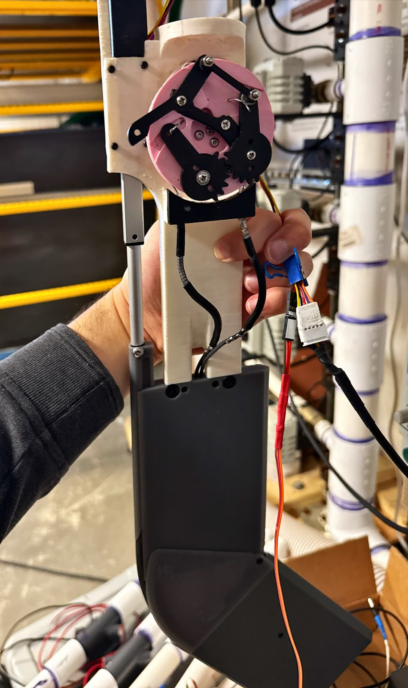
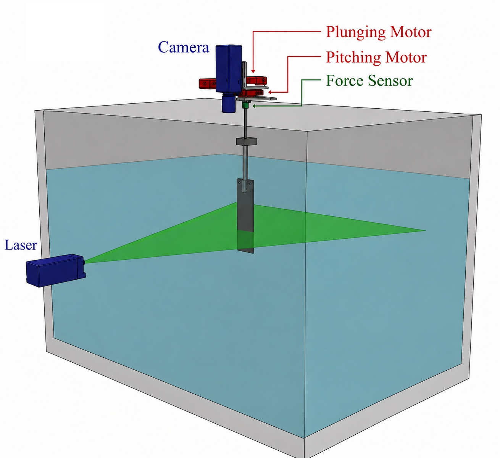

**Research, WEAR Lab. Completed April 2025**

A morphing airfoil for submersed flow analysis, with user controlled telescopic span and variable sweep angle.
 

**Project goals**
- Allow independent, user controlled adjustment of wingspan and sweep angle during underwater flow testing.
- Create a Bowden cable mechanism that telescopes the wingspan, plus a cable tensioning system.
- Deliver responsive, accurate control suitable for real time flow experiments.

<video class="lazy-video" loop muted playsinline preload="none" style="width: 250px;">
<source src="/assets/video/wing_animation.mp4" type="video/mp4">
</video>

- A linear actuator controls the sweep angle.
- A servo controls the wingspan.
- The user sends input to an Arduino Uno over serial.
- Wrote and optimized the control firmware in C/C++ for speed, accuracy and ease of use.

Project role: **Systems Integrator**. I was responsible for bringing the separate pieces and prototypes together into one deliverable.

<video class="lazy-video" loop muted playsinline preload="none" style="width: 600px;">
<source src="/assets/video/tensioning_sidebyside.mp4" type="video/mp4">
</video>
- The tensioning mechanism uses principles from EML 3262 Kinematics of Mechanisms.
- Once the 4-bar linkage reaches its toggle position, the links lock in place.
- The locked linkage holds the Bowden cables tight like a vise. That tensions the pulley system that engages the telescopic wingspan.

**Experimental application**

<video class="lazy-video" loop muted playsinline preload="none" style="width: 400px;">
<source src="/assets/video/wing_in_tank.mp4" type="video/mp4">
</video>

- The wing rig is lowered into a water tank, actuated by plunging and pitching motors and instrumented with a force sensor to capture hydrodynamic loads.
- A laser sheet and camera positioned along the tank enable Particle Image Velocimetry (PIV), which tracks seeded flow around the wing as span and sweep change.

<video class="lazy-video" loop muted playsinline preload="none" style="width: 500px;">
<source src="/assets/video/tank_flow_results.mp4" type="video/mp4">
</video>
- This is raw PIV footage. The laser sheet lights up tracer particles seeded in the tank, and the wing's edge is visible cutting through the flow.
- These particle fields get post processed into velocity vectors, which show how the wake changes with sweep angle.

