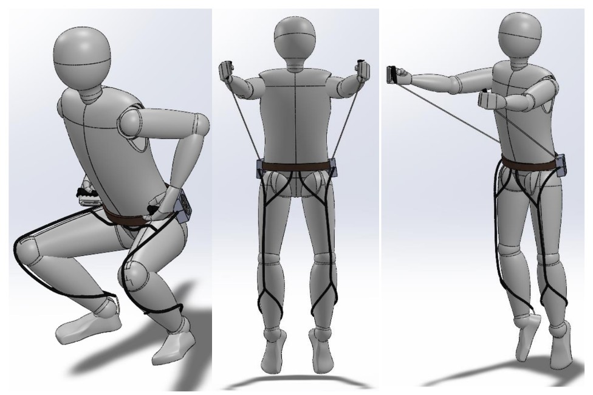
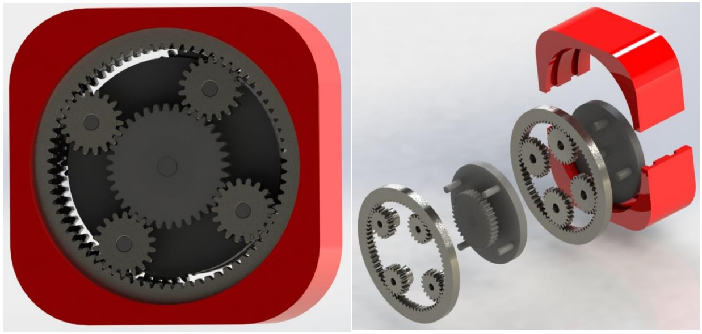
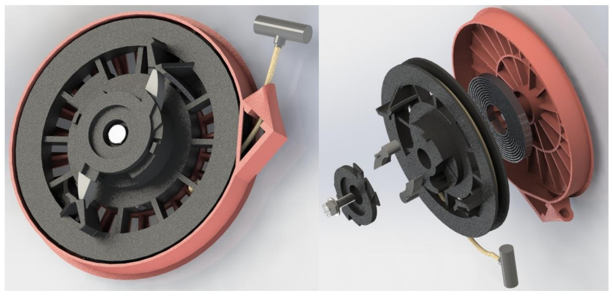

**Research project, WEAR Lab. Completed March 2023**

An unpowered exosuit that improves a person's ability to jump by mechanically coupling the arms and legs.
Most jump assist exoskeletons are either powered and heavy for the gains they provide, or passive but only effective from a deep squat.
None of them make use of arm swing, even though arm swing on its own is known to add to vertical jump height.
 
**Project goals**
- Mechanically couple arm swing to leg extension to boost jump height with no onboard power source.
- Prototype a compact energy storage and release mechanism (a planetary gearbox with a reverse engineered pull start) to transmit arm motion to the legs.
- Keep the suit fully unpowered and wearable, relying purely on mechanical coupling.

**CAD design**

- As CAD Designer, I modeled the exosuit in SolidWorks. A hip belt holds the gearbox and two recoil devices per side. An input cable runs from a handle to one recoil device,
and an output cable runs from the other down to the back of the heel.
- Pulling the handles through the squat to jump motion rotates the ankle into plantarflexion right as the legs extend, adding the arms' energy to the jump.

- Modeled a prototype planetary gearbox to convert the cable length pulled by the hands into the shorter length needed at the ankle. The target was a 12:1 conversion ratio in as small a package as possible.
- I chose a planetary layout over other gearbox types for its size to torque advantage, and because staging its ratios makes it more compact.

- Reverse engineered a pull start mechanism so it could be modified to integrate the planetary gear system.
- Each cable spools onto its own spring loaded recoil device. This keeps the line tensioned at all times and lets the user move freely when the mechanism is disengaged.
- The input side recoil device is also where the upper and lower body coupling engages and disengages.

Presented as a poster: *"Human Augmentation via Upper-Lower Body Coupling (HAULC),"* Department of Mechanical and Aerospace Engineering, University of Central Florida.
