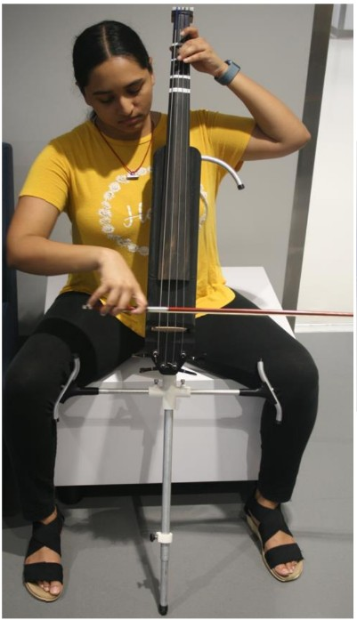
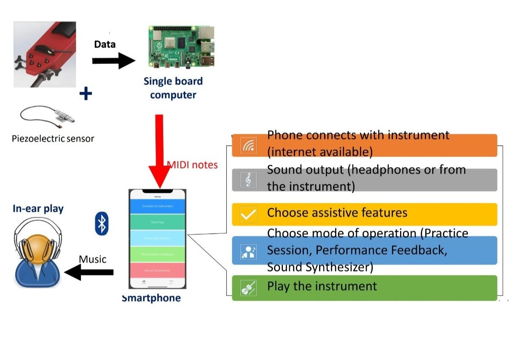
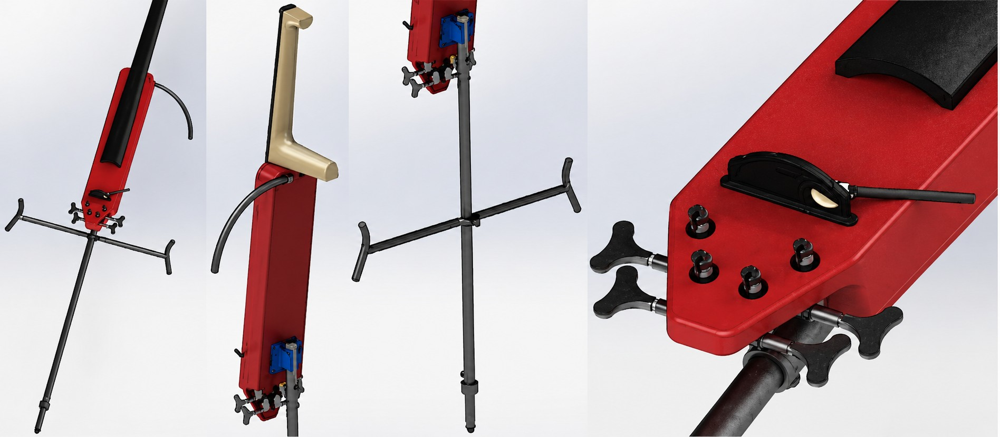

**Research project, WEAR Lab. Completed February 2022**

A cello designed for minimum size, ease of assembly and disassembly, ease of use and silent operation.
Regular cellos are heavy, bulky and hard to practice on without disturbing whoever is nearby.
This project set out to shrink the instrument, quiet it down and add digital feedback for practice.
The goal was to do all that without giving up the feel of playing a real cello.
 
**Project goals**
- Shrink the cello's footprint for portability without sacrificing playability.
- Design for quick assembly and disassembly using 3D printed parts, wood and metal reinforcement.
- Make it silent enough to practice on without disturbing others.

**Project overview**

- A single board computer reads the piezoelectric sensor in the bridge and converts the signal to MIDI notes. The notes stream over Bluetooth to a companion smartphone app.
- The app lets the player pick assistive features and switch between practice, performance feedback and sound synthesizer modes. The player hears the result through headphones for silent practice.

Project role: **CAD Designer**

- Designed in SolidWorks and built from 3D printed parts, wood and metal reinforcement.
I broke the instrument down to only its most vital components to shrink its overall size.
- Silent strings and no resonant box cut the volume significantly.
- A piezoelectric sensor in the bridge picks up the vibration needed to reconstruct the sound.

Presented as a poster: *"Mechatronic Musical Instrument (MMI),"* Department of Mechanical and Aerospace Engineering, University of Central Florida, 2023. [View the full poster](/posters/).
