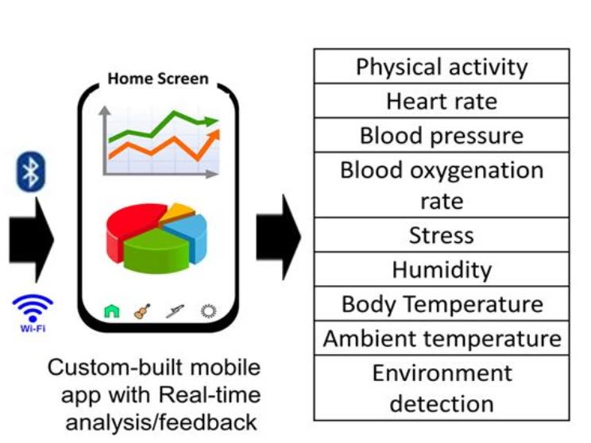
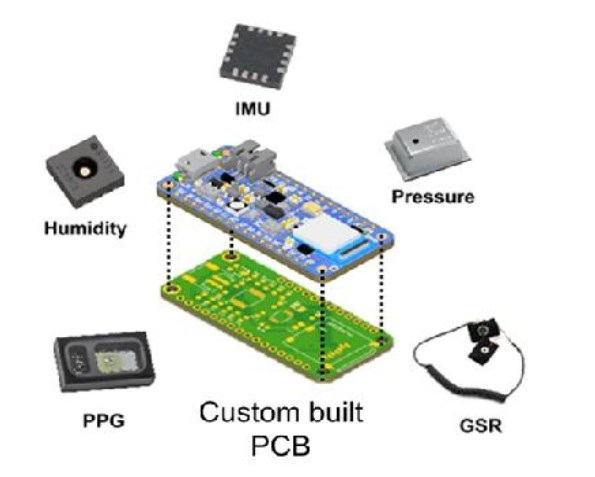
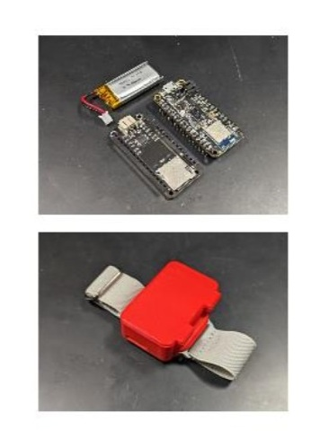

**Research project, WEAR Lab. Completed September 2023**

An open source, wrist mounted health and activity monitor with IMU and PPG sensing. Most wearable biomechanics and physiologic sensors are standalone systems with proprietary hardware and incompatible communication protocols. That makes it hard to combine several of them for synchronized, real time measurement in the field. This project fills that gap with a single wrist worn device and a companion app.
 
**Project goals**
- Combine IMU and PPG sensing into a single open source, wrist mounted device.
- Validate the device's accuracy against commercially available actigraphy devices.
- Minimize the device's footprint through a custom housing and wrist mount design.

Project role: **Research Assistant**

- The device streams data over Bluetooth or Wi-Fi to a companion smartphone app for real time visualization and analysis. The app covers physical activity, heart rate, blood pressure, blood oxygenation, stress and body/ambient temperature.
- Implemented a protocol to assess the device's accuracy against commercially available actigraphy devices.

- A custom PCB integrates IMU, pressure, humidity, PPG (heart rate) and GSR sensors with a microcontroller and battery, stacked into a compact wearable module.
- Fabricated the housing and wrist mount for the electronics. It keeps the overall footprint small while leaving the board and battery accessible.

**Research application**

I developed the testing method used to validate the device against commercially available actigraphy devices, working with the EMBRACE Lab. That collaboration led to an NIH funded study and to my co-authorship on the resulting publication in *Frontiers in Aging*.

Presented as a poster: *"Multimodal Human and Ambient Sensing System (MUHASS),"* Department of Mechanical and Aerospace Engineering, University of Central Florida.
