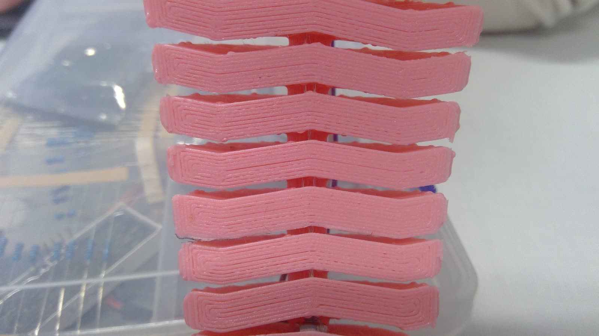
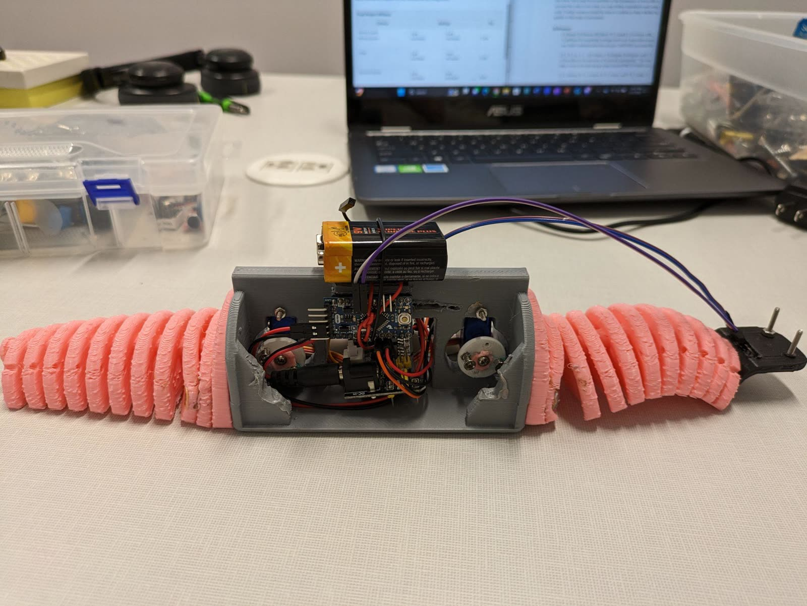

**EGN 4060C Intro to Robotics. Completed December 2023**

A soft bodied robot, built with two other ME students, that emulates a worm's inching locomotion and seeks out red targets with an RGB sensor.
 

**Project goals**
- Emulate a worm's inching locomotion with a soft, flexible body instead of rigid linkages.
- Give the robot autonomous color seeking behavior, so it starts moving when it detects a red target.
- Balance body geometry and weight distribution so the motion at each end adds up to net forward travel instead of just rocking in place.

**CAD and electronics**

- As CAD and Electronics Lead, I designed the 3D printed body, a rigid center chassis between two flexible arms made of tiled scales. Most of the robot's weight stays centered, so one end's contraction can't just slide the whole robot instead of producing a net gait.
- The scales can't slide past one another, so each arm stays rigid in the horizontal plane while it compresses. That let us add side to side wave motion as a stretch goal on top of up and down motion.
- Routed nylon wire beneath each arm's joint with the chassis. Contracting the wire creates a moment that shifts more of the robot's weight onto that end. That raises its friction against the ground at the right point in the gait.

- Built the power system and wiring for two SG90 servos, an Arduino Pro Mini, a TCS34725 RGB sensor, a 9V battery and a voltage regulator.
- The Pro Mini has no onboard USB, so it was programmed through an Arduino Uno wired to the host laptop.
- Wrote the control loop. The TCS34725 streams raw red, green, blue and clear values, and a check for red dominance triggers the gait. Both arms contract, then the back arm releases before the front so it pushes the front forward.

**Results**

The robot reproduced the worm's inching gait. It contracted both ends, then released the back end first so it pushed the front end forward, the same way an organic worm moves. Getting there took a lot of iteration. The servo timing, wire tension and component layout inside the body all needed reworking before the contraction and release delays lined up correctly.

The main limitation was speed. Published measurements put nematode worms at 15.9 to 250 micrometers per second. Even accounting for the difference in scale, our robot moved orders of magnitude faster than that. The slow, deliberate character of the gait itself remained, though. That points to speed being an inherent property of wavelike locomotion rather than something specific to our implementation. It's worth testing further with higher torque servos or different flexible materials.
